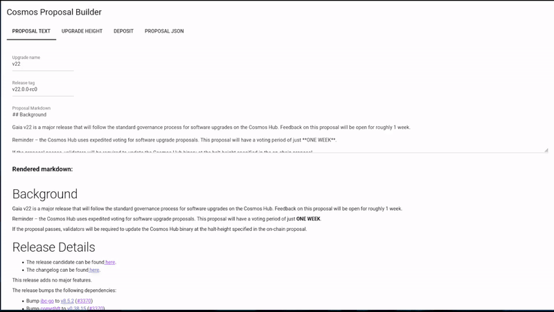

# cosmos-proposal-builder
Helps you build software upgrade proposals.

## Usage

### Python

* This will open a browser on localhost:8080.
```
python -m pip install -r requirements.txt
python src/main.py
```

### Docker

* This will serve the site on localhost:8000.
```
docker build -t proposal-builder .
docker run --rm -p 8000:8080 proposal-builder
```

### Configuration

| Variable | Default | Description |
| --- | --- | --- |
| `HOST` | `0.0.0.0` | Interface to listen on |
| `PORT` | `8080` | Port to listen on |
| `OPEN_BROWSER` | `true` (`false` in the image) | Open a browser tab on startup |
| `BASIC_AUTH_USERNAME` | unset | Basic auth username |
| `BASIC_AUTH_PASSWORD` | unset | Basic auth password |

Basic auth is enabled only when both `BASIC_AUTH_USERNAME` and `BASIC_AUTH_PASSWORD` are set. `/healthz` is always open.

## Remote deployment

The image is built on the remote host from a clone of this repository.

1. Clone the repository on the host:
   ```
   git clone https://github.com/hyphacoop/cosmos-proposal-builder.git
   cd cosmos-proposal-builder
   ```
2. Copy `.env.deploy.example` to `.env.deploy` and set the basic auth credentials.
3. Build and start the app:
   ```
   docker compose up -d --build
   ```
4. To update, pull the latest code and rebuild:
   ```
   git pull && docker compose up -d --build
   ```

The container only listens on `127.0.0.1:8080`, so nginx must handle TLS and forward requests to it. The app uses a websocket, so the proxy must pass the upgrade headers:

```nginx
location / {
    proxy_pass http://127.0.0.1:8080;
    proxy_http_version 1.1;
    proxy_set_header Upgrade $http_upgrade;
    proxy_set_header Connection "upgrade";
    proxy_set_header Host $host;
    proxy_set_header X-Forwarded-For $proxy_add_x_forwarded_for;
    proxy_set_header X-Forwarded-Proto $scheme;
    proxy_read_timeout 86400;
}
```

To serve the app under a subpath such as `/proposal_builder`, strip the prefix with a trailing slash on `proxy_pass` and pass it to the app in `X-Forwarded-Prefix`, so the page loads its scripts and websocket from the right path:

```nginx
location = /proposal_builder {
    return 301 /proposal_builder/;
}

location /proposal_builder/ {
    proxy_pass http://127.0.0.1:8080/;
    proxy_http_version 1.1;
    proxy_set_header Upgrade $http_upgrade;
    proxy_set_header Connection "upgrade";
    proxy_set_header Host $host;
    proxy_set_header X-Forwarded-Prefix /proposal_builder;
    proxy_set_header X-Forwarded-For $proxy_add_x_forwarded_for;
    proxy_set_header X-Forwarded-Proto $scheme;
    proxy_read_timeout 86400;
}
```

Run a single container: each user's session state lives in that process's memory.


